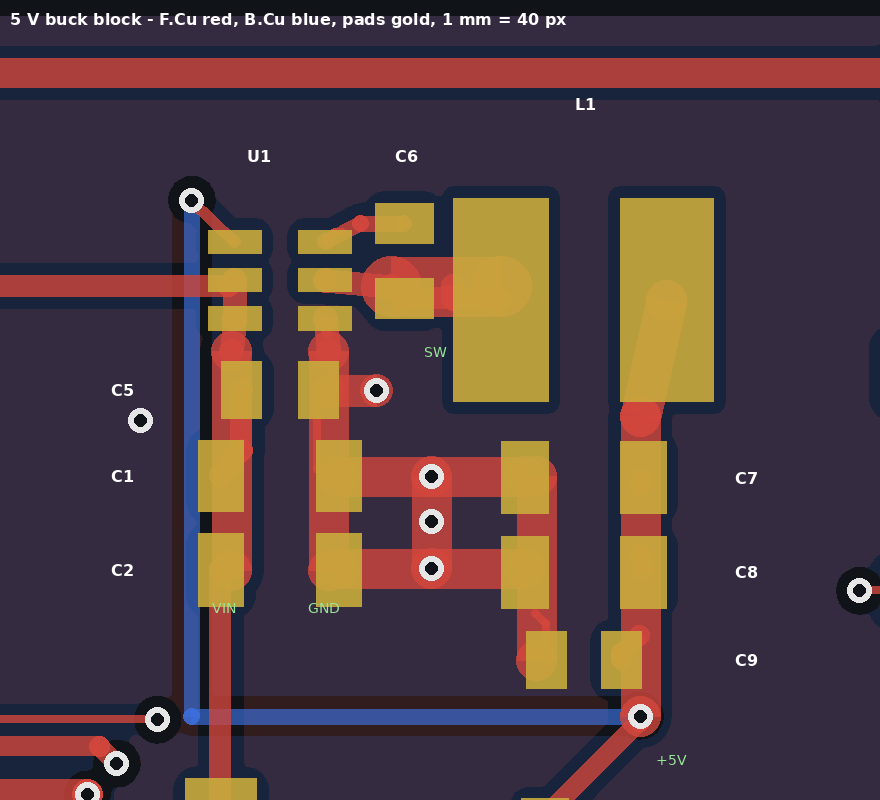

# 04 — PCB layout (v0.1, autorouted first pass)

Status: **first complete layout pass — not ready to order.** Placement, routing and
pours are all generated by script from the schematic, so the board stays in step with the
design table. The items in section 6 still need a hand-review pass in KiCad before fab.

Images: `layout_placement.png` (placement plus ratsnest), `layout_routed.png` (routed copper).

## 1. Stackup and rules

| Layer | Use |
|----|----|
| F.Cu | Components and signals, GND pour |
| In1.Cu | Solid GND plane (KiCad "power" layer; not routed) |
| In2.Cu | Signals, GND pour |
| B.Cu | Signals, GND pour; CN2 (gate-board connector) is mounted on this side |

- Board: 4 layers, 2.0 mm thick (confirmed).
- Minimum track and clearance: 0.15 mm (DRC limit). The router works at 0.2 / 0.2 mm,
  which every standard 4-layer fab process can build.
- Vias: 0.6 mm pad, 0.3 mm drill.
- Copper-to-edge clearance: 0.4 mm.
- Copper weight: not fixed yet. The AP63205 datasheet suggests 2 oz copper to help the
  regulator shed heat. 1 oz is the usual cheaper default. Which to order is a fab choice to
  settle before ordering.

Net classes are in `tools/gen_route.py`, `NETCLASSES`:

| Class | Width / clearance (mm) | Nets |
|----|----|----|
| POWER | 0.8 / 0.3 | VBAT, VBAT_SW, VCC_12V, +12V_GATE, contactor/pump outputs, SW_5V, resolver exciter (EXC_*) |
| SUPPLY | 0.5 / 0.2 | +5V, +3V3, +5V_A, VDDA, ESP_3V3, sensor 5 V rails, CHASSIS, Q1_IN/Q2_IN |
| default | 0.2 / 0.2 | everything else |

FreeRouting cannot narrow a track where it enters a pad. So a class width is automatically
capped at 0.05 mm below the narrowest SMD pad on that net. For example, +3V3 and VDDA
become 0.25 mm because they land on 0.3 mm LQFP pins. The script prints the classes it
actually applied. In the committed run:

| Width / clearance (mm) | Nets |
|----|----|
| 0.8 / 0.3 | VBAT, contactor/pump outputs, EXC_OA_C, EXC_P/N |
| 0.75 / 0.3 | VBAT_SW, +12V_GATE |
| 0.55 / 0.3 | VCC_12V, SW_5V, EXC_OA/OB |
| 0.5 / 0.2 | +5V, +5V_A, ESP_3V3, sensor 5 V rails, CHASSIS, Q1_IN/Q2_IN |
| 0.25 / 0.2 | +3V3, VDDA |

## 2. Flow (all scripted, re-runnable)

```
python3 tools/gen_mech.py     # outline, holes, CN1/CN2 at measured positions
python3 tools/gen_layout.py   # load netlist, cross-check every pad, place parts
python3 tools/gen_route.py    # plane, pre-route, FreeRouting x2, GND vias, pours, DRC, render
```

`gen_route.py` steps:

1. **Pre-route short pad pairs.** These are same-net pads within 4 mm of each other:
   adjacent CN2 pins, decoupling caps to their pins, and tied IC pins. Each pair becomes a
   locked straight or L-shaped track, but only where it clears all foreign copper.
   FreeRouting otherwise tends to box these pins in and leave them open.
2. **GND fan-out before routing.** Every SMD GND pad gets a short stub and a via to the In1
   plane, so the router works around them:
   - ICs (LQFP/SOIC) put the via inward, under the body.
   - Passives put it beside the pad.
3. **FreeRouting stage 1.** A full autoroute, up to 40 passes (more passes only made some runs
   take over an hour; the completion step below closes what's left). A stage-2 re-run on the
   stage-1 result only happens if more than a few connections are left open. FreeRouting
   1.9 sometimes hangs on that re-run, so it has a timeout and falls back to stage 1.
4. **SES import.** This is a custom importer, because KiCad 7's importer needs the GUI. It
   first checks that the placement in the SES matches the board exactly. FreeRouting omits
   fixed wires from its SES, so the import starts from the board that already holds the
   pre-routes.
5. **Cleanup and completion.**
   - Router leftovers that KiCad's DRC flags as dangling (tracks, and vias connected on one
     layer only) are deleted.
   - Any connection still open is closed in this order, using the first that works:
     1. A straight or L track, with a via where it has to change layer.
     2. A grid search (0.05 mm grid, F/In2/B, through vias) between the two connected copper
        clusters.
     3. The same search allowed to cross other nets' tracks at a cost. The crossed tracks are
        ripped up and their nets closed again, up to 4 rounds. New copper is never ripped.
   - FreeRouting's own second pass is skipped by default. FreeRouting 1.9 reproducibly hangs
     on it ("normalization of net OCUR_OK failed").
6. **GND stitching grid** (about 7 mm). It ties the F/In2/B pours to the In1 plane, kept out
   of component bodies.
7. **GND pours on F/In2/B, filled.**
   - SMD pads connect solid; THT pads get thermal reliefs.
   - Islands without a connection are removed.
   - An island that only reaches GND through an SMD pad gets its own via, then the board is
     refilled.
8. **DRC.** The report goes to `route_work/drc.rpt`. `bolt_logic.kicad_dru` accepts one
   pour spoke on through-hole pads, since those are also tied to the In1 plane. The copper
   is rendered to `docs/layout_routed.png`.

FreeRouting is not deterministic, so two runs give different (equally valid) copper. The
committed board is the reviewed run.

## 3. Placement

Parts are grouped by function into regions spread across the whole board, following the
signal flow. Coordinates use the design frame from `02-mechanical.md` (origin H1, x to the
right, y up). CN1 sits on the left tab at y ≈ 37–80; CN2 runs along the bottom left at
x ≈ −2…50, y ≈ 11–18.

Placement rules (`gen_layout.py`):
- **Connector clearance (owner):** no component within **10 mm** of CN1 or CN2, for hand
  soldering. It is measured from the connector's pads, locating holes and outline to each
  part's pads and outline, and checked after placement (the run fails otherwise). In the
  committed placement the nearest parts are Q1 at 12.2 mm from CN1 and U7 at 11.6 mm from
  CN2. Tracks and vias may pass through the zone.
- **Legible references:** each part's placement box includes its silkscreen reference, with
  1.5 mm between boxes. So no reference sits on a pad or on another reference, and every
  reference stays on the silkscreen.

| Group | Region (x, y in mm) | Why there |
|----|----|----|
| Power (TVS, 12 V switches, 5 V buck, 3.3 V LDO) | x 12…105, y 80…106 | Near CN1's battery and ignition pins (rows K–M) |
| CAN | x 12…45, y 48…78 | Beside CN1's CAN pins |
| Resolver / encoder | x 12…105, y 48…80 | Between CN1's sensor pins and the MCU |
| Analog front end (current, UDC buffers, comparators, temperature mux) | x 12…112, y 27…48 (+ strip below CN2) | Above CN2's sensor pins |
| Gate interface (PWM latch, fault logic, UDC divider) | x 59…113, y −3…27 (+ strip below CN2) | Right of CN2's PWM / status pins |
| MCU (STM32F103, crystals, SWD) | x 113…175, y 0…55, centred at (140, 28) | Board centre: short runs to every group |
| Vehicle inputs (dividers, filters, polyfuses) | x 105…200, y 55…80 | |
| Low-side / high-side outputs | x 105…200, y 80…106 | Along the top edge |
| ESP32-WROOM-32E (as V6) + support parts | x 175…262, y −5…55 | Module on the bottom edge, between H5 and H11, with the antenna end flush with the edge (Espressif placement guidance). The footprint's antenna keep-out is 48 mm wide, covers the last ~6 mm of board on all four copper layers, and has no copper, vias or pour. The bottom edge is the only stretch long enough with no mounting hole in it: on the right edge, H11/H12 leave only 43.5 mm. |

Decoupling caps are placed against the pin they serve (`NEAR` table in `gen_layout.py`).
Two-pin parts can rotate in 90° steps so that each pad faces its own net.

### 3.1 5 V buck block (U1 AP63205 and its parts)

A switching regulator's layout is part of the circuit, and the general placer only
knows connectivity: in the first pass the input caps ended up 13–16 mm from U1 and the
switching node was 18 mm of 0.55 mm track. So the buck is now a fixed, hand-designed block
in `tools/buck_block.py`. `gen_layout.py` places it first, and `gen_route.py` draws its
copper as locked tracks and vias before anything else, so the autorouter only connects
VCC_12V into it and +5V out of it.

The layout follows the AP63205 datasheet's layout guidance and the AP63205 EVB:

```
           U1 label  C6 label     L1 label
    FB via o   [U1]  [C6]   +--------------+
               VIN|GND  \_SW__|  L1 (SW|5V)  |
    C5 label [C5 VIN|GND]      +--------------+
    C1 label [C1 VIN|GND]  o   [C7 GND|5V]  C7 label
    C2 label [C2 VIN|GND]  o   [C8 GND|5V]  C8 label
                               [C9 GND|5V]  C9 label
                     FB return o
```

| | Block | First pass |
|----|----|----|
| Input loop | C5 (100 nF) pads 1.8 mm from the VIN/GND pins, then C1 and C2 (10 µF) stacked below on 1 mm VIN and GND buses | input caps 13–16 mm away |
| Bootstrap | C6 upright beside the BST/SW pins, about 2 mm away | ~19 mm |
| SW node | one 1.5 mm wide strip, about 4.4 mm from the SW pin to L1 pad 1 | 18 mm of 0.55 mm track |
| Output | C7, C8 (22 µF) and C9 (100 nF) under L1 on a 1 mm +5V bus; their GND ties straight across to the input-cap GND | routed |
| GND | four vias in the input/output cap grounds to the In1 plane, plus the F.Cu pour | fan-out vias |
| FB | U1 pin 1 senses +5V. It drops through a via next to the pin and runs on B.Cu to the output caps, with the In1 GND plane between it and the SW node | routed |



*`docs/buck_block.png`, made by `tools/render_block.py`: F.Cu red, B.Cu blue, pads gold.*

The block's copper stays locked in the committed board, so a hand edit elsewhere in KiCad
won't drag it, and the completion step's rip-up never touches it. The block's silkscreen references sit around its outside, level with their parts, since
there's no room for a label beside each part. The GND fan-out step leaves the block's GND
pads alone, because it has its own vias.

Values are unchanged. The datasheet's typical circuit uses 4.7 µH; this board keeps
6.8 µH, which is what the AP63205 EVB uses.

## 4. Results (committed run)

| | |
|----|----|
| Parts | 241 placed, every pad's net checked against the KiCad netlist; nothing within 10 mm of CN1/CN2 |
| Connections | CN1, CN2, J1 (SWD), J4 (ESP32 programming); TP1/TP2 are bare test pads on CN2 pins 20/18 |
| Tracks | 2 480 segments: F.Cu 4.1 m, In2.Cu 5.3 m, B.Cu 1.2 m |
| Vias | 711 (498 GND fan-out / stitching / buck block), 0.6 / 0.3 mm |
| DRC | **0 clearance, short or keep-out violations; 0 unconnected items; 0 silkscreen overlaps** |
| DRC warnings left | 2 where the ESP32 outline meets the board edge (module flush with the edge, by design), 199 `lib_footprint_issues` (see below) |
| Router-closed connections | none needed |

## 5. DRC items that are expected / environmental

- `lib_footprint_issues`: this headless environment has no global footprint-library
  table, so DRC cannot compare footprints with the library. This does not happen in a
  normal KiCad install.
- `silk_edge_clearance` (2): the ESP32 module's outline runs to the board edge, because
  the antenna end sits flush with the edge.

## 6. Hand-review list before fab

| # | Area | What to do |
|----|----|----|
| 1 | **5 V buck (U1, L1, C1/C2/C5, C6)** | **Done:** fixed block, §3.1. Left to check: whether to order 2 oz outer copper, which the datasheet suggests for heat (§1). |
| 2 | **Resolver exciter (U13 to CN1)** | EXC_* carries ~100 mA at 10 kHz. Keep it away from SIN/COS and run the pairs side by side. |
| 3 | **Analog inputs (IL1, IL2, UDC, SIN/COS, temps)** | Check that no PWM or exciter track runs parallel on an adjacent layer. Add a GND guard where it does. |
| 4 | **PWM to CN2** | Six lines: check they are short, reference the In1 plane, and don't cross a plane gap. |
| 5 | **Smart switches (Q1/Q2 BTS443P high-side, U20–U22 BTS133TC low-side)** | Add copper area on the tabs for heat; widen output traces if the load needs it. |
| 6 | **CHASSIS** | Mounting-hole ring and the R7 tie to GND: confirm the single-point bond location. |
| 7 | **Mechanical** | Height is now checked (section 7). Any lid or rib keep-outs in the housing are still unknown. |
| 8 | **Pre-layout checklist** | `03-schematic-design.md` §8: L272D, BTS443P (TO-252-4 vs -5), BTS133TC, AP63205 values, CN1 hole sizes, CN2 height. |
| 9 | **+3V3 trunk** | The router could only use one width per net, so +3V3 is 0.25 mm everywhere, and it feeds the ESP32, whose transmit peaks approach 0.5 A. Widen the trunk from U2 to the MCU / ESP32 area by hand, or give it a short In2 pour. |
| 10 | **Silkscreen** | References are placed and clear of each other. Still to add: board name, revision, CN2 pin 1, and the HV warning. |

## 7. Height limit

Owner: about 7/8" (22.2 mm) maximum height, measured from the bottom of the board. That
leaves about 20.2 mm above the component side of the 2.0 mm board. `gen_layout.py` checks
every footprint against this, using datasheet maximum body heights, and fails on any part
that is over the limit or has no height on file.

| Part | Height (mm) | Margin |
|----|----|----|
| J1 SWD, J4 ESP programming (2.54 mm vertical headers) | 8.5 unmated | OK |
| U20–U22 BTS133TC (TO-263) | 4.83 | OK |
| L1 SRN6045TA | 4.5 | OK |
| U30 ESP32-WROOM-32E | 3.35 | OK |
| Everything else | ≤ 3.0 | OK |

Points to check:
- **J1 / J4:** bench use only (programming), so mated height doesn't matter in service.
- **CN1:** excluded from the check. Its height is set by the housing opening, and the header
  part isn't chosen yet.
- **CN2:** on the bottom side, mating with the gate board.

